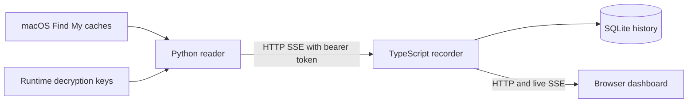

# findmy-history

Record Apple Find My locations in SQLite and explore them on a live map. A macOS reader decrypts local caches and publishes snapshots over Server-Sent Events (SSE); a TypeScript service stores distinct fixes and serves a Chinese-language Leaflet dashboard.

The project includes Nix packages, a NixOS recorder module, and a Home Manager module for the macOS reader. It uses local Find My data, rather than an Apple web API. It is not affiliated with Apple.

## How it works



- **People:** decrypts `LocalStorage.db` and its committed WAL frames, then joins friend identities with secure locations.
- **Devices and items:** authenticates and decrypts `Devices.data` and `Items.data` using the FMIP cache key. Items can include AirTags and individual accessory components.
- **History:** deduplicates fixes by object, source timestamp, and coordinates. Replayed snapshots do not create duplicate points. Missing source timestamps stay `null`; an untimed fix does not replace a latest fix whose timestamp is known.
- **Dashboard:** object filters, selectable time ranges, map tracks, a location timeline, live collection status, and GeoJSON export.

The reader samples every 30 seconds. It briefly pauses the cache writer while copying the encrypted database and WAL into memory, resumes it in `finally`, validates WAL checksums, and applies only committed frames. Decrypted SQLite stays in memory; the reader does not write plaintext database snapshots or modify Apple's caches.

Cache sampling does not request fresh locations from Apple. On the validated macOS build, Find My stops refreshing five minutes after losing focus, even though its process remains alive. The supervisor renews the session every four minutes: it sends `SIGTERM` only to this user's Find My app, waits for that process to exit, then starts it in the background without activating it. Reopening an existing process does not renew the session. The cache reader and SSE connection stay running throughout; Photos and Apple's location agents are not restarted. This means enabling the reader also periodically closes any Find My window the collecting user has opened.

This follows the background relaunch approach in [FollowMyFriends](https://github.com/bytePatrol/FollowMyFriends/blob/967a82e5af6f4d0e8742136b5fb728d9191f8f46/FollowMyFriends/Services/FindMyLauncher.swift), verified here for people, devices and items. This reader leaves Find My running between renewals to collect intermediate updates. Revalidate this behavior after upgrading macOS: it depends on Find My's private application lifecycle. Available objects and source fix frequency still depend on Apple, sharing settings and device reachability; renewing a session does not guarantee a new fix for every object.

## Nix quick start

Provision the runtime cache keys, shared token, and macOS permissions described below. The examples use `192.168.50.10` as the Mac's private address; replace it with your own.

```sh
# On the Mac, bind the source to its private interface.
nix run .#source -- --host 192.168.50.10

# On the recorder host, use a file containing the same token.
nix build .#dashboard
FINDMY_SOURCE_URL=http://192.168.50.10:8766/events \
FINDMY_TOKEN_FILE="$HOME/.local/state/findmy/source.token" \
FINDMY_DB="$PWD/history.sqlite" \
  nix run .
```

Open `http://127.0.0.1:8787` on the recorder host. The recorder connects directly to the Mac over HTTP and sends `Authorization: Bearer TOKEN` on its SSE request. Keep this connection on a trusted private network and restrict source access to the recorder. The dashboard itself has no login; keep it private or place it behind an authenticated reverse proxy.

### Flake outputs

| Output | Purpose |
| --- | --- |
| `packages.<system>.dashboard`, `packages.<system>.default` | Node.js 24 recorder with bundled web assets. |
| `packages.<system>.source` | Python reader with PyCryptodome; macOS only. |
| `devShells.<system>.default` | Node.js 24, Python 3.13 with PyCryptodome, Alejandra, and Ruff. |
| `checks.<system>.dashboard` | Build, TypeScript checking, and recorder tests. |
| `checks.<system>.reader` | Python cache-reader tests. |
| `formatter.<system>` | Alejandra, invoked with `nix fmt -- .`. |
| `nixosModules.default` | NixOS recorder service. |
| `homeManagerModules.source` | macOS Home Manager launch agent. |

The flake supports `x86_64-linux`, `aarch64-linux`, `x86_64-darwin`, and `aarch64-darwin`; source packages are exposed only on Darwin. `nix run` uses each package's `meta.mainProgram`, so separate app definitions are unnecessary. Cache-reader runtime behavior has been validated on macOS 26.6.2 on Intel. A successful package build on another platform does not establish compatibility with that platform's Find My cache format.

## macOS setup

The reader needs a logged-in graphical macOS session, an Apple Account with Find My available, decryption keys, and permission to read protected caches. It is not a headless or login-window service.

### Runtime keys

Extract keys separately using an appropriate upstream tool, such as [findmy-key-extractor](https://github.com/sabey/findmy-key-extractor). Key extraction is not part of this project. Some extraction procedures require temporarily changing SIP or AMFI settings; follow the upstream instructions and restore normal protections afterward. Routine collection can run with SIP enabled once keys are available.

Provision these files in the collecting user's home directory:

| Runtime file | Used for |
| --- | --- |
| `~/.local/state/findmy/keys/LocalStorage.key` | People locations; exactly 32 raw bytes. |
| `~/.local/state/findmy/keys/FMIPDataManager.bplist` | Device and item cache decryption. |

`FMFDataManager.bplist` is not needed by this reader. Keep the key directory private and the files readable only by the collecting user:

```sh
mkdir -p ~/.local/state/findmy/keys
chmod 700 ~/.local/state/findmy ~/.local/state/findmy/keys
# Copy the extracted files into the keys directory, then:
chmod 600 ~/.local/state/findmy/keys/LocalStorage.key \
  ~/.local/state/findmy/keys/FMIPDataManager.bplist
```

Do not commit keys, embed them in a Nix expression, or import them into the Nix store. They stay on the Mac; the recorder receives decrypted location records over authenticated HTTP.

### Shared source token

Create a nonempty token file on the Mac:

```sh
umask 077
mkdir -p ~/.local/state/findmy
openssl rand -hex 32 > ~/.local/state/findmy/source.token
chmod 600 ~/.local/state/findmy/source.token
```

Provision the same value on the recorder using your runtime secret-management system. Both files should have mode `0600` and be owned by the user running the respective service. Keep tokens out of Git and the Nix store. The HTTP token is separate from the cache decryption keys above.

The source accepts `--host` (default `127.0.0.1`) and `--token-file` (default `~/.local/state/findmy/source.token`). It requires a nonempty token file and checks the bearer header on every GET, including `/events` and `/healthz`; missing or incorrect credentials return HTTP 401.

### Terminal and privacy permissions

The reader's supervisor starts its worker in Terminal so the worker can use Terminal's Full Disk Access. Grant **Terminal** Full Disk Access in **System Settings → Privacy & Security → Full Disk Access**. Start the source in the logged-in session and approve macOS Automation access to control Terminal when requested. The permission may be associated with the packaged Python interpreter, so an interpreter upgrade can require another approval.

The supervisor owns a Terminal window for the worker and closes it during shutdown. Leave the session logged in. Logging out stops collection; the module does not configure automatic login or alter macOS privacy permissions.

### Home Manager

Add the flake input to your configuration:

```nix
inputs.findmy-history.url = "github:gaoyifan/findmy-history";
```

Import the module in the collecting user's Home Manager configuration. This example assumes flake inputs are available through `extraSpecialArgs`:

```nix
{ inputs, ... }: {
  imports = [ inputs.findmy-history.homeManagerModules.source ];
  services.findmy-source = {
    enable = true;
    host = "192.168.50.10";
  };
}
```

| Option under `services.findmy-source` | Default |
| --- | --- |
| `enable` | `false` |
| `package` | The reader derivation. |
| `host` | `127.0.0.1`; set the Mac's private interface address for remote collection. |
| `tokenFile` | `~/.local/state/findmy/source.token`, resolved under the collecting user's home directory. |

The module asserts Darwin, starts only in an Aqua session, and maintains the launch agent `org.nix-community.home.findmy-source` with `KeepAlive` and launchd's default 10-second restart throttle. Logs go to `~/Library/Logs/findmy-source.log`. It does not create the token file or change network access rules.

```sh
launchctl print "gui/$(id -u)/org.nix-community.home.findmy-source"
tail -n 30 ~/Library/Logs/findmy-source.log
curl -fsS -H "Authorization: Bearer $(cat ~/.local/state/findmy/source.token)" \
  http://192.168.50.10:8766/healthz
```

The source health endpoint confirms that snapshots are being produced. Each snapshot's `sources` fields report readability and `updatedAt`, the cache file's last write time (including the WAL for people). This is separate from `observedAt`, when the reader sampled the files, and each location's `timestamp`, when Apple obtained that fix. The dashboard displays cache write ages alongside its snapshot connection status. A readable cache or a newly received snapshot does not establish that the source positions are fresh.

## NixOS recorder

Import the NixOS module and point it directly at the Mac's HTTP source. This example assumes flake inputs are passed through `specialArgs`:

```nix
{ inputs, ... }: {
  imports = [ inputs.findmy-history.nixosModules.default ];
  services.findmy = {
    enable = true;
    sourceUrl = "http://192.168.50.10:8766/events";
    tokenFile = "/run/secrets/findmy-source-token";
  };
}
```

| Option under `services.findmy` | Default |
| --- | --- |
| `enable` | `false` |
| `package` | The flake's dashboard derivation. |
| `sourceUrl` | Required; full snapshot SSE URL. |
| `dataDir` | `/var/lib/findmy` |
| `host` | `127.0.0.1` |
| `port` | `8787` |
| `tokenFile` | `null`; set a runtime token file when connecting to the built-in macOS source. |

The service and system user/group are named `findmy`. Provision `tokenFile` with the same value as the Mac's token, owned by `findmy` with mode `0600`. The service creates `dataDir` at startup with ownership `findmy:findmy` and mode `0700`; SQLite files use a private umask. It does not create a separate default directory when `dataDir` changes. No tmpfiles rule runs before a custom data volume is mounted.

For an encrypted or separately mounted data volume, add the necessary `requires`/`after` dependencies to `systemd.services.findmy` in your host configuration. A host-specific `ExecStartPre` check can use `lib.mkBefore` to verify the mount before directory creation. The module starts under `multi-user.target`; use `lib.mkForce` to replace `wantedBy` if the host needs a separate unlock target. The module does not manage mounts, token provisioning, certificates, or firewall exposure.

```sh
systemctl status findmy
journalctl -u findmy --since '10 minutes ago'
curl -fsS http://127.0.0.1:8787/healthz
```

## Manual configuration and API

Without the NixOS module, the dashboard reads these environment variables:

| Variable | Meaning |
| --- | --- |
| `FINDMY_SOURCE_URL` | Required full snapshot SSE URL. |
| `FINDMY_DB` | SQLite path; defaults to `/var/lib/findmy/findmy.sqlite`. |
| `FINDMY_TOKEN_FILE` | Runtime bearer-token file; required to authenticate to the built-in macOS source. |
| `HOST` | Listen address; defaults to `127.0.0.1`. |
| `PORT` | Listen port; defaults to `8787`. |

The collector reads `FINDMY_TOKEN_FILE` and sends its value in the `Authorization: Bearer TOKEN` header. The NixOS option remains nullable for other upstreams, but the built-in macOS source always requires authentication.

- `GET /api/status`: connection state, last source observation and receipt, per-source status, and counts.
- `GET /api/entities`: identities, latest known locations, availability, and point counts.
- `GET /api/track?kind=person&id=...&from=...&to=...&limit=10000`: chronological points and a `truncated` flag. The default range is 24 hours; maximum range is 366 days and maximum limit is 20,000. Truncated results contain the latest matching points.
- `GET /api/events`: SSE status updates for the browser.
- `GET /healthz`: HTTP 200 when the source connection is up and the latest snapshot was both observed and received within 120 seconds; otherwise HTTP 503. Individual cache failures remain visible in the JSON status.

Authenticated requests to the source endpoint `GET /events` receive `event: snapshot` every 30 seconds and a heartbeat approximately every 10 seconds. It sends the current snapshot to each new subscriber. Snapshots contain `observedAt`, `locations`, and per-cache `sources` status. Locations contain `kind` (`person`, `device`, or `item`), a stable `id`, `name`, nullable coordinates, accuracy, and a nullable source timestamp. All non-null timestamps carry a timezone and are normalized to UTC by the recorder.

The recorder retries every five seconds after a stream failure, including 90 seconds without a snapshot. It resumes from the current cache snapshot. Fixes overwritten by Apple during an outage cannot be recovered from that snapshot.

## Data and maps

History is stored in SQLite using WAL mode, without automatic expiration. Failed source reads and temporarily unavailable coordinates do not erase existing history. Untimed fixes use their first observation for date-range filtering while retaining a null source timestamp in the database and exports.

For an online backup, use SQLite's backup API or command. Copying only the main database file can omit committed changes still in the WAL.

Application assets and Leaflet are served locally. The browser loads OpenStreetMap tiles when viewing recorded positions; the tile provider receives the viewed map area and the site's origin as the Referer, excluding entity query strings. No reverse geocoding is performed. Follow the [OpenStreetMap tile usage policy](https://operations.osmfoundation.org/policies/tiles/) when hosting the dashboard.

## Development and tests

```sh
nix develop
npm ci
npm run check
npm test
python -m unittest discover -s macos -p test_source.py -v
nix flake check
nix fmt -- .
```

The TypeScript tests cover replay deduplication, unknown and out-of-order source times, retained history when sources fail, SSE framing across UTF-8 chunks, and reconnect behavior. Python tests cover committed WAL handling, corrupt tails, database truncation, writer resumption after a failed copy, and item cache identifiers with source timestamps. These tests use synthetic data and do not require Apple credentials or private decryption keys.

To build and run the dashboard directly after `npm ci`, use `npm run build` and then `npm start` with the environment variables above. The Python reader requires PyCryptodome and macOS runtime permissions; the development shell supplies its Python dependency.

## License and acknowledgements

Project code is available under the [MIT License](LICENSE). The LocalStorage cipher and FMIP envelope implementation draw on upstream reverse-engineering work. See [THIRD_PARTY_NOTICES.md](THIRD_PARTY_NOTICES.md) for source links, revisions, and the complete upstream license notices, including Leaflet's bundled browser code.
